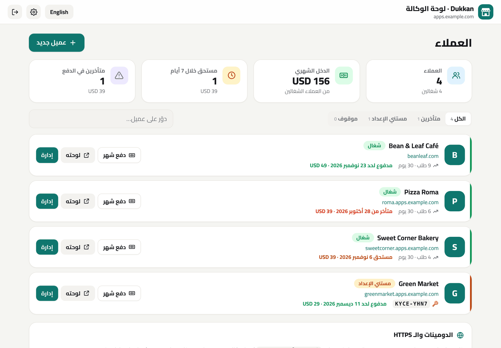

<div dir="rtl">

<div align="center">


# دكّان · Dukkan

**متجرك ومنيو الـ QR بتاعك على واتساب، وشغّال في دقيقتين.**
على سيرفرك، من غير عمولات، وبـ 8 لغات جاهزة.

[](https://www.hostinger.com/docker-hosting?compose_url=https://raw.githubusercontent.com/mashraf1997/dukkan/main/docker-compose.yml&REFERRALCODE=YOUR_REFERRAL_CODE)

[English](README.md) · [العربية](README.ar.md)

</div>

---

## ليه دكّان؟

ملايين المطاعم والكافيهات والمخابز والبيزنس المنزلي بياخدوا طلباتهم على **واتساب**. لكن العميل لازم يسأل "المنيو فيه إيه؟"، والأسعار بتضيع في الشات، والطلبات بتوصل فويسات مش واضحة.

البرامج الجاهزة بتحل ده بـ **15 لـ 50 دولار في الشهر + عمولة على كل طلب**. دكّان بيعمل نفس الحاجة بتمن أرخص سيرفر:

1. **انشر** التطبيق بضغطة واحدة، والـ HTTPS بيتعمل لوحده.
2. **افتح محلك** من خلال إعداد بياخد دقيقة (فيه منيو تجريبي بلغتك عشان يبان شغّال من أول لحظة).
3. **شارك اللينك أو الـ QR.** العميل يتفرج على منيو شيك على الموبايل، ويختار، ويضغط **"إرسال الطلب على واتساب"**. والطلب بيوصلك مترقّم ومتحسوب ومنظّم.

## المميزات


**التصميم**
- 🎨 **4 ثيمات**: عصري، وشبكة صور، وفخم (غامق زي منيو المطاعم المطبوع)، وجريء. ومعاها **5 خطوط** كلها بتدعم العربي، وأي لون تختاره
- 📱 **معاينة حية على شكل موبايل** في لوحة التحكم: أي تغيير يبان فورًا، وتنشره لما تكون مبسوط
- ✨ تفاصيل متشطبة: حالة "مفتوح دلوقتي" حية، وأزرار سريعة للواتساب والاتصال والخريطة والمشاركة، وقسم "الأكثر طلبًا"، والمنتج بيطير للسلة، وعلامة صح متحركة لما الطلب يتبعت

**للعميل**
- ⚡ منيو سريع ومعمول للموبايل الأول
- 🌍 **8 لغات**: العربية، والإنجليزي، والإسباني، والبرتغالي، والفرنساوي، والتركي، والإندونيسي، والهندي، والعميل يغيّر اللغة من المنيو
- 🧺 سلة بأحجام واختيارات، وكل حجم بسعره
- 🚚 توصيل (مع **مناطق توصيل** لكل منطقة رسومها)، 🛍️ استلام، أو 🍽️ **طلب من الترابيزة برقمها**
- 🏷️ **أكواد خصم** وقت الطلب
- 💬 ضغطة واحدة تبعت الطلب منظّم لواتساب المحل

**لصاحب المحل**
- 🧙 إعداد في دقيقة، مع منيو تجريبي لو حابب
- 📊 لوحة تحكم: مؤشرات مع **مقارنة بالفترة اللي قبلها**، ورسم بياني تفاعلي، و**أوقات الذروة**، والعملاء بيطلبوا إزاي، و**عدد الزوار ونسبة اللي طلبوا منهم**، والأكثر مبيعًا
- 🧾 صندوق طلبات بحالات، وصوت تنبيه، وتكلّم العميل بضغطة، و**طباعة إيصال** بمقاس طابعة الكاشير
- 📲 **إشعارات تيليجرام فورية** لكل طلب جديد، ببلاش ومن خلال بوت خاص بيك
- 📄 **استيراد وتصدير المنيو من Excel أو Google Sheets**
- 🕒 **مواعيد عمل أوتوماتيك**: المحل بيفتح ويقفل لوحده حسب الجدول، وبيدعم المواعيد اللي بتعدّي نص الليل
- 📱 QR للمحل، وبوسترات QR جاهزة للطباعة لكل ترابيزة
- 💾 نسخة احتياطية واسترجاع بضغطة

**للسيرفر**
- 3 مكتبات بس، ومفيش قاعدة بيانات محتاجة إعداد، وبيشتغل على أصغر VPS (حوالي 70 ميجا رام)
- **HTTPS أوتوماتيك** عن طريق Caddy، كل اللي عليك تكتب الدومين
- **كود إعداد** بيحمي التثبيت الجديد، عشان محدش غيرك يقدر ياخد المحل
- **وضع ديمو** لنسخة تجريبية عامة بترجع لحالتها الأصلية كل ساعة
- 🔌 **توصيلات اختيارية**: دفع أونلاين (Paymob وStripe)، رسايل واتساب أوتوماتيك، إيميل، إشعارات على الموبايل، ونسخ احتياطي يومي (التفاصيل في **التوصيلات** تحت)

## النشر

### الطريقة 1: ضغطة واحدة على Hostinger VPS (الأفضل)

1. اضغط **Deploy on Hostinger** فوق.
2. **لو عايز HTTPS:** وجّه سجل الـ **A** بتاع الدومين لـ IP السيرفر، وحط متغير البيئة `DOMAIN=shop.example.com`، والشهادة هتتعمل وتتجدد لوحدها.
3. **كود الإعداد:** افتح **اللوج (Logs)** بتاع حاوية `dukkan` من Docker Manager، وانسخ السطر `Setup code: XXXX-XXXX`. أو حدد الكود بنفسك في متغير `SETUP_CODE` قبل النشر.
4. افتح الدومين وادخل على `/admin`، واكتب الكود، وكمّل الإعداد.

### الطريقة 2: Node.js web app على هوستنجر

1. من hPanel: **Websites ← Add website ← Node.js app ← Import Git repository**.
2. الـ Framework هو **Express**، ونسخة Node **20 أو أحدث**، وملف البداية `server.js`.
3. ضيف متغيرين:
   - `SETUP_CODE`: أي كود تختاره، وهتكتبه وقت الإعداد.
   - `DATA_DIR`: فولدر **برّه** فولدر التطبيق (مثلًا `/home/<user>/dukkan-data`).
4. اعمل Deploy، وافتح الدومين، وكمّل الإعداد.

### الطريقة 3: Docker

```bash
DOMAIN=shop.example.com docker compose up -d
```

```bash
docker compose logs dukkan | grep "Setup code"
```

## إشعارات تيليجرام

توصلك رسالة على موبايلك ببلاش أول ما يوصل طلب جديد، حتى ولو لوحة التحكم مقفولة:

1. في تيليجرام افتح [‎@BotFather](https://t.me/BotFather) وابعت `/newbot`، وانسخ التوكن.
2. حط التوكن في **الإعدادات ← إشعارات فورية (تيليجرام)**، وبعدين افتح البوت الجديد ودوس **Start**.
3. دوس **لاقي المحادثة** وبعدين **ابعت تجربة**.

التوكن بيتحفظ على السيرفر بتاعك بس، ومش بيظهر تاني في المتصفح، ومش بيدخل في النسخة الاحتياطية.

## التوصيلات (اختيارية)

كل حاجة شغالة من غيرها. شغّل اللي محتاجه بس من **لوحة التحكم ← التوصيلات**. المفاتيح وكلمات السر بتفضل على السيرفر بتاعك: عمرها ما بتتبعت للمتصفح ولا بتدخل في النسخ الاحتياطية.

### الدفع أونلاين: Paymob أو Stripe

لما توصّل شركة دفع، العميل يقدر يدفع بعد ما يطلب على طول؛ الطلب بيتعلّم **مدفوع أونلاين** وبيتأكد لوحده.

- **Paymob** (مصر، السعودية، الإمارات، عمان، باكستان): حط الـ Secret key والـ Public key والـ HMAC وأرقام الـ Integration من لوحة Paymob، وبعدين حط لينك الـ callback اللي ظاهر في اللوحة في خانة *Transaction processed callback*.
- **Stripe** (كل الدول): حط الـ Secret key (`sk_live_…` أو `sk_test_…`). ولو عايز، ضيف Webhook على `https://دومينك/webhooks/stripe` للحدث `checkout.session.completed` وحط الـ signing secret بتاعه.
- كل دفعة بتتأكد من الشركة لما العميل يرجع، وتاني من الـ Webhook لو قفل الصفحة. المبلغ والعملة بيتراجعوا، والدفعة بتتحسب مرة واحدة بس. جرّب بمفاتيح تجريبية وزرار **افتح دفعة تجريبية**.
- طريقة الدفع اليدوي ولينك الدفع بتوعك بيفضلوا شغالين لو مفيش شركة دفع.

### رسايل واتساب أوتوماتيك (WhatsApp Cloud API)

من غيرها، لينكات واتساب بضغطة شغالة زي ما هي. ومعاها، الرسايل دي بتتبعت لوحدها من رقم البيزنس بتاعك:

| الرسالة | بتتبعت إمتى | اسم القالب |
|---|---|---|
| تأكيد الطلب | الطلب يتدفع أونلاين أو تدوس **تأكيد** | `dukkan_confirmed` |
| الطلب جاهز | تدوس **تم ✓** على الطلب | `dukkan_ready` |

1. اعمل App على [Meta for Developers](https://developers.facebook.com/) وضيفله WhatsApp، وانسخ الـ **Phone number ID** و**Access token دائم** (System user).
2. واتساب مش بيسمح للبيزنس يبدأ محادثة غير بقالب متوافق عليه. اعمل كل قالب بالنص اللي ظاهر في اللوحة بالظبط (فيه زرار نسخ)، استنى الموافقة، وبعدين شغّله.
3. **ابعت تجربة** بيبعت قالب `hello_world` بتاع Meta عشان تتأكد إن التوصيل شغال. Meta بتحاسب على المحادثات اللي البيزنس بيبدأها حسب أسعارها.

### الإيميل (SMTP)

أي إيميل ينفع، زي إيميل هوستنجر (`smtp.hostinger.com`، بورت 465 مع SSL/TLS أو 587). لما توصّل الإيميل، بيوصلك تنبيه بكل طلب جديد والنسخة الاحتياطية اليومية على الإيميل. التنبيهات والنسخة اليومية كل واحدة ليها زرار تشغيل لوحدها.

### إشعارات على الجهاز ده

لوحة التحكم تتثبت على الشاشة الرئيسية للموبايل زي أي تطبيق. دوس **شغّل الإشعارات** على كل جهاز عايزه يوصله إشعار فوري بكل جديد من غير تيليجرام (على الآيفون ضيف اللوحة للشاشة الرئيسية الأول؛ iOS 16.4 أو أحدث). إشعارات تيليجرام لسه شغالة برضه.

### نسخ احتياطي يومي أوتوماتيك

كل يوم التطبيق بيحفظ نسخة في `DATA_DIR/backups/` وبيحتفظ بآخر 14 يوم. تقدر تنزّل أي واحدة من اللوحة، أو تدوس **اعمل نسخة دلوقتي**. شغّل **ابعتلي النسخة الاحتياطية كل يوم** عشان يبقى فيه نسخة مضغوطة برّه السيرفر. وللاسترجاع: **الإعدادات ← نسخة احتياطية ← استرجاع نسخة**. ولو حصل خطأ أو النسخة فشلت، بيوصلك تنبيه (مرة كل ساعة بالكتير).

### باسم وكالتك (White-label)

من لوحة الوكالة (`/hub` ← الإعدادات) حط اسم وكالتك وموقعك: كل صفحات العملاء هتكتب "بواسطة *وكالتك*" بدل دكّان، أو تخفي السطر خالص. وشاشة دخول العملاء بتظهر اسمك برضه.

## وضع الوكالة: كل عملاءك على سيرفر واحد

لو إنت فريلانسر أو وكالة، تقدر تشغّل **سيرفر دكّان واحد لعملاء كتير**. كل عميل بياخد متجر مستقل تمامًا (لوحة تحكم وكلمة سر وبيانات وصور خاصة بيه) على `client.yourdomain.com` أو على الدومين بتاعه، وبـ HTTPS أوتوماتيك. وإنت بتدير الكل من لوحة واحدة على `/hub`.



- ➕ **عميل جديد في ثواني**: تختار الاسم والعنوان، وتبعتله اللينك وكود الإعداد على واتساب بضغطة
- 🌐 **دومين فرعي أو دومين العميل نفسه**، والشهادة بتطلع أوتوماتيك أول ما حد يفتح الصفحة
- 💰 **متابعة الاشتراكات**: المبلغ الشهري، ومدفوع لحد إمتى، واللي قرب ميعادهم واللي متأخرين، وزرار "دفع شهر"
- ⏸️ **إيقاف** العميل اللي ما دفعش (صفحته بيظهر فيها "مش متاحة دلوقتي") ورجوعه بضغطة
- 🔑 **كلمة سر جديدة** للعميل اللي نسي كلمة السر
- 🗑️ لما تحذف عميل، بياناته بتتنقل لفولدر `trash/` ومش بتتمسح

**التشغيل** (من فولدر [`examples/agency/`](examples/agency)):

1. وجّه سجلين DNS للسيرفر: `apps.example.com` و`*.apps.example.com`.
2. شغّل ملف الـ compose بـ `BASE_DOMAIN=apps.example.com`.
3. افتح `https://apps.example.com/hub` واكتب كود الإعداد اللي في اللوج.

## فروع كتير

كل فرع بيبقى ليه نسخة مستقلة: لوحة تحكم، ومنيو، وبيانات، ورقم واتساب، وغالبًا على دومين فرعي خاص بيه (`downtown.example.com` و`mall.example.com`). النسخة خفيفة جدًا (حوالي 70 ميجا رام)، فسيرفر صغير يشيل فروع كتير.

في فولدر [`examples/branches/`](examples/branches) هتلاقي `docker-compose.yml` و`Caddyfile` جاهزين لفرعين مع HTTPS أوتوماتيك. عشان تضيف فرع: انسخ بلوك الخدمة، واديله volume جديد، وضيف سطر في الـ `Caddyfile`. وجّه الـ DNS بتاع كل دومين فرعي للسيرفر، وشغّل `docker compose up -d`، وافتح `/admin` على كل دومين عشان تجهّزه. وعلى Hostinger VPS ممكن كمان تنشر القالب أكتر من مرة.

## استيراد المنيو من Excel

من **المنيو ← استيراد من Excel / CSV**، نزّل النموذج واملاه، واحفظه CSV، وارفعه. العمود الوحيد المطلوب هو `name`. الأحجام بتتكتب كده: `وسط:120 | كبير:160`، والأقسام بتتعمل لوحدها.

## ملاحظة أمان

التثبيت الجديد مش بيتفتح غير بكود الإعداد اللي في لوج السيرفر (أو `SETUP_CODE`)، فلو حد عرف الـ IP بتاعك مش هيقدر ياخد المحل.

## الترخيص

[MIT](LICENSE): مجاني للاستخدام الشخصي والتجاري.

</div>
