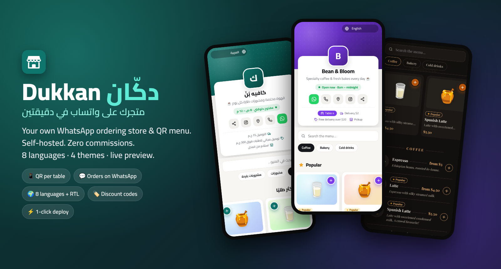
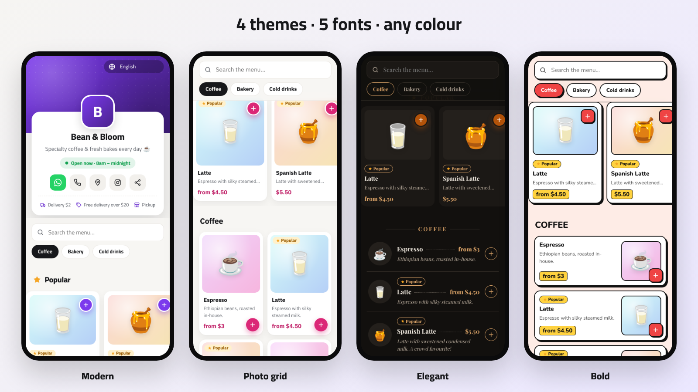

<div dir="rtl">

<div align="center">



# دكّان · Dukkan

**متجرك ومنيو الـ QR بتاعك على واتساب، وشغّال في دقيقتين.**
على سيرفرك، من غير عمولات، وبـ 8 لغات جاهزة.

[](https://www.hostinger.com/docker-hosting?compose_url=https://raw.githubusercontent.com/mashraf1997/dukkan/main/docker-compose.yml&REFERRALCODE=YOUR_REFERRAL_CODE)

[English](README.md) · [العربية](README.ar.md)

</div>

---

## ليه دكّان؟

ملايين المطاعم والكافيهات والمخابز والبيزنس المنزلي بياخدوا طلباتهم على **واتساب**. لكن العميل لازم يسأل "المنيو فيه إيه؟"، والأسعار بتضيع في الشات، والطلبات بتوصل فويسات مش واضحة.

البرامج الجاهزة بتحل ده بـ **15 لـ 50 دولار في الشهر + عمولة على كل طلب**. دكّان بيعمل نفس الحاجة بتمن أرخص سيرفر:

1. **انشر** التطبيق بضغطة واحدة، والـ HTTPS بيتعمل لوحده.
2. **افتح محلك** من خلال إعداد بياخد دقيقة (فيه منيو تجريبي بلغتك عشان يبان شغّال من أول لحظة).
3. **شارك اللينك أو الـ QR.** العميل يتفرج على منيو شيك على الموبايل، ويختار، ويضغط **"إرسال الطلب على واتساب"**. والطلب بيوصلك مترقّم ومتحسوب ومنظّم.

## المميزات



**التصميم**
- 🎨 **4 ثيمات**: عصري، وشبكة صور، وفخم (غامق زي منيو المطاعم المطبوع)، وجريء. ومعاها **5 خطوط** كلها بتدعم العربي، وأي لون تختاره
- 📱 **معاينة حية على شكل موبايل** في لوحة التحكم: أي تغيير يبان فورًا، وتنشره لما تكون مبسوط
- ✨ تفاصيل متشطبة: حالة "مفتوح دلوقتي" حية، وأزرار سريعة للواتساب والاتصال والخريطة والمشاركة، وقسم "الأكثر طلبًا"، والمنتج بيطير للسلة، وعلامة صح متحركة لما الطلب يتبعت

**للعميل**
- ⚡ منيو سريع ومعمول للموبايل الأول
- 🌍 **8 لغات**: العربية، والإنجليزي، والإسباني، والبرتغالي، والفرنساوي، والتركي، والإندونيسي، والهندي، والعميل يغيّر اللغة من المنيو
- 🧺 سلة بأحجام واختيارات، وكل حجم بسعره
- 🚚 توصيل (مع **مناطق توصيل** لكل منطقة رسومها)، 🛍️ استلام، أو 🍽️ **طلب من الترابيزة برقمها**
- 🏷️ **أكواد خصم** وقت الطلب
- 💬 ضغطة واحدة تبعت الطلب منظّم لواتساب المحل

**لصاحب المحل**
- 🧙 إعداد في دقيقة، مع منيو تجريبي لو حابب
- 📊 لوحة تحكم: مؤشرات مع **مقارنة بالفترة اللي قبلها**، ورسم بياني تفاعلي، و**أوقات الذروة**، والعملاء بيطلبوا إزاي، و**عدد الزوار ونسبة اللي طلبوا منهم**، والأكثر مبيعًا
- 🧾 صندوق طلبات بحالات، وصوت تنبيه، وتكلّم العميل بضغطة، و**طباعة إيصال** بمقاس طابعة الكاشير
- 📄 **استيراد وتصدير المنيو من Excel أو Google Sheets**
- 🕒 **مواعيد عمل أوتوماتيك**: المحل بيفتح ويقفل لوحده حسب الجدول، وبيدعم المواعيد اللي بتعدّي نص الليل
- 📱 QR للمحل، وبوسترات QR جاهزة للطباعة لكل ترابيزة
- 💾 نسخة احتياطية واسترجاع بضغطة

**للسيرفر**
- مكتبتين بس، ومفيش قاعدة بيانات محتاجة إعداد، وبيشتغل على أصغر VPS (حوالي 60 ميجا رام)
- **HTTPS أوتوماتيك** عن طريق Caddy، كل اللي عليك تكتب الدومين
- **كود إعداد** بيحمي التثبيت الجديد، عشان محدش غيرك يقدر ياخد المحل
- **وضع ديمو** لنسخة تجريبية عامة بترجع لحالتها الأصلية كل ساعة

## النشر

### الطريقة 1: ضغطة واحدة على Hostinger VPS (الأفضل)

1. اضغط **Deploy on Hostinger** فوق.
2. **لو عايز HTTPS:** وجّه سجل الـ **A** بتاع الدومين لـ IP السيرفر، وحط متغير البيئة `DOMAIN=shop.example.com`، والشهادة هتتعمل وتتجدد لوحدها.
3. **كود الإعداد:** افتح **اللوج (Logs)** بتاع حاوية `dukkan` من Docker Manager، وانسخ السطر `Setup code: XXXX-XXXX`. أو حدد الكود بنفسك في متغير `SETUP_CODE` قبل النشر.
4. افتح الدومين وادخل على `/admin`، واكتب الكود، وكمّل الإعداد.

### الطريقة 2: Node.js web app على هوستنجر

1. من hPanel: **Websites ← Add website ← Node.js app ← Import Git repository**.
2. الـ Framework هو **Express**، ونسخة Node **20 أو أحدث**، وملف البداية `server.js`.
3. ضيف متغيرين:
   - `SETUP_CODE`: أي كود تختاره، وهتكتبه وقت الإعداد.
   - `DATA_DIR`: فولدر **برّه** فولدر التطبيق (مثلًا `/home/<user>/dukkan-data`).
4. اعمل Deploy، وافتح الدومين، وكمّل الإعداد.

### الطريقة 3: Docker

```bash
DOMAIN=shop.example.com docker compose up -d
```

```bash
docker compose logs dukkan | grep "Setup code"
```

## استيراد المنيو من Excel

من **المنيو ← استيراد من Excel / CSV**، نزّل النموذج واملاه، واحفظه CSV، وارفعه. العمود الوحيد المطلوب هو `name`. الأحجام بتتكتب كده: `وسط:120 | كبير:160`، والأقسام بتتعمل لوحدها.

## ملاحظة أمان

التثبيت الجديد مش بيتفتح غير بكود الإعداد اللي في لوج السيرفر (أو `SETUP_CODE`)، فلو حد عرف الـ IP بتاعك مش هيقدر ياخد المحل.

## الترخيص

[MIT](LICENSE): مجاني للاستخدام الشخصي والتجاري.

</div>
