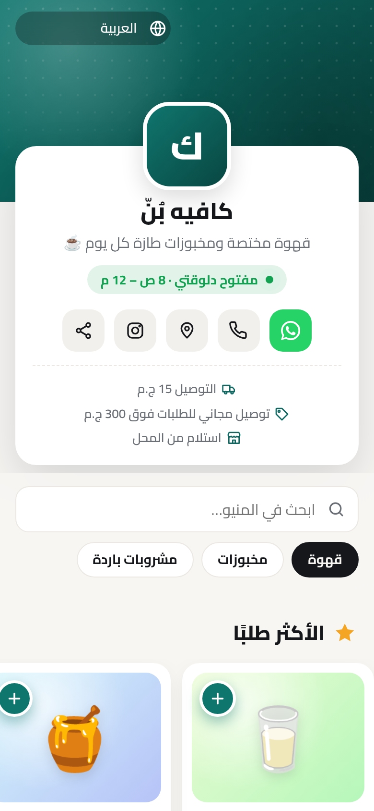
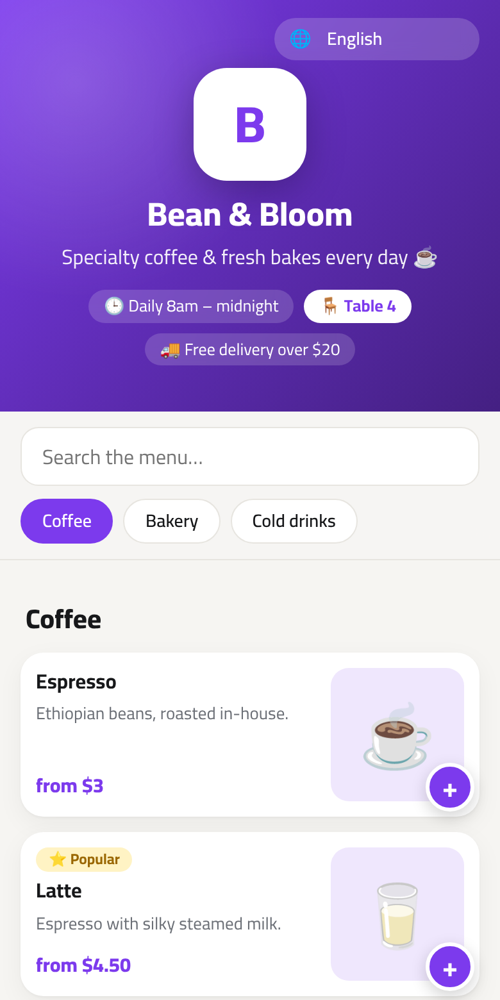
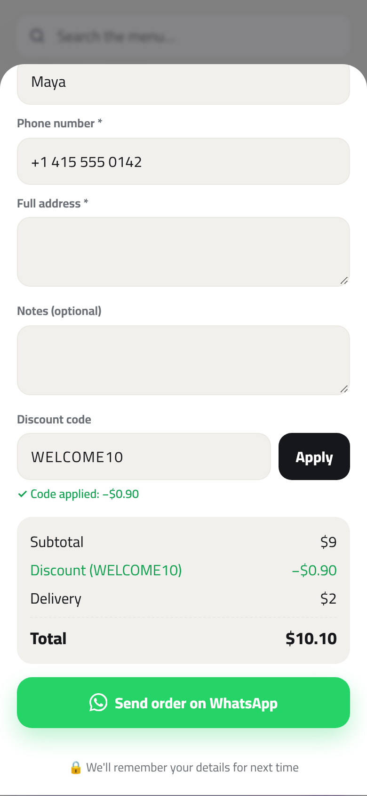
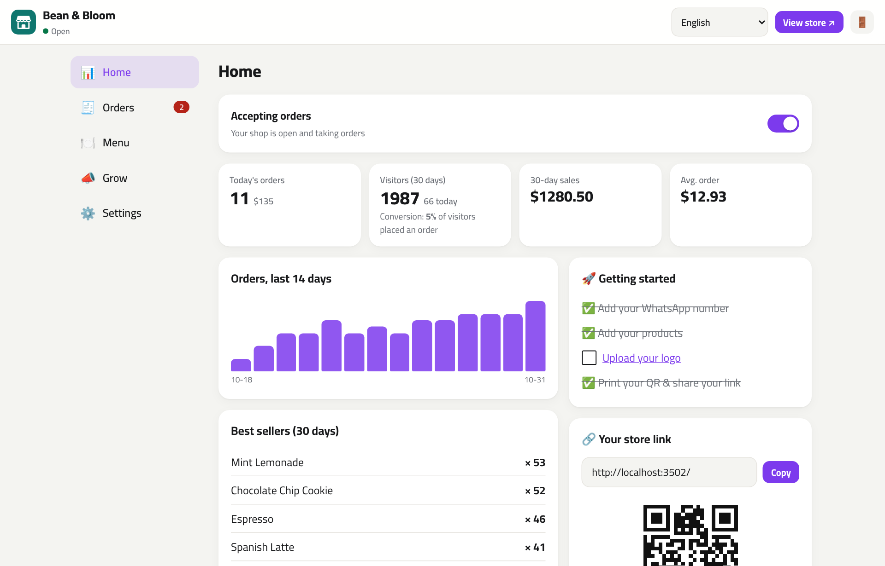
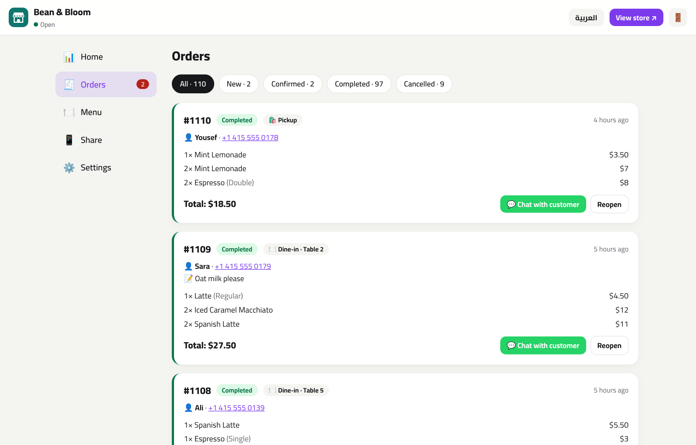
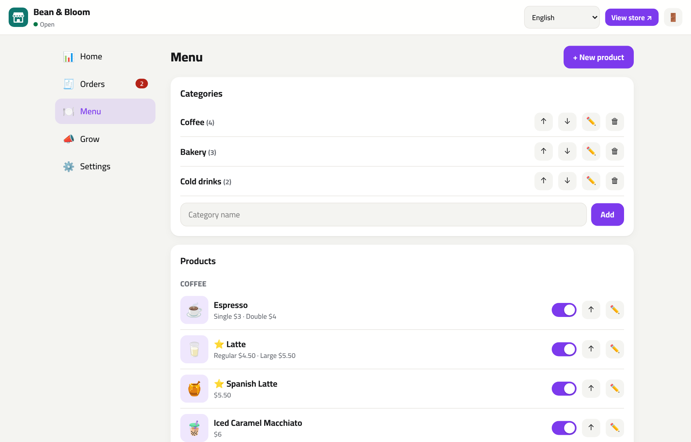
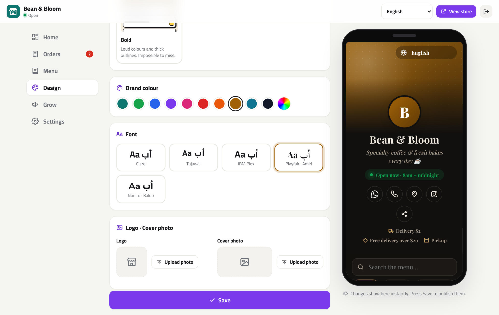
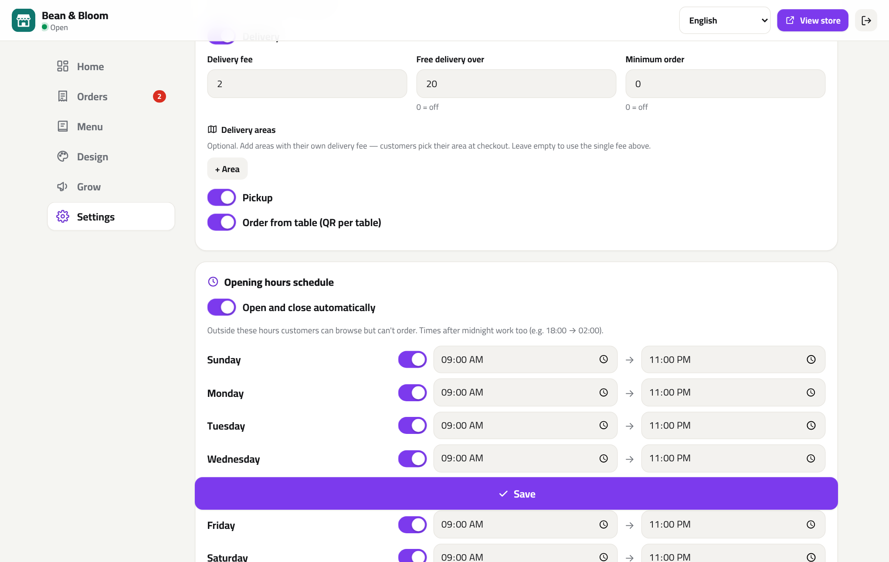
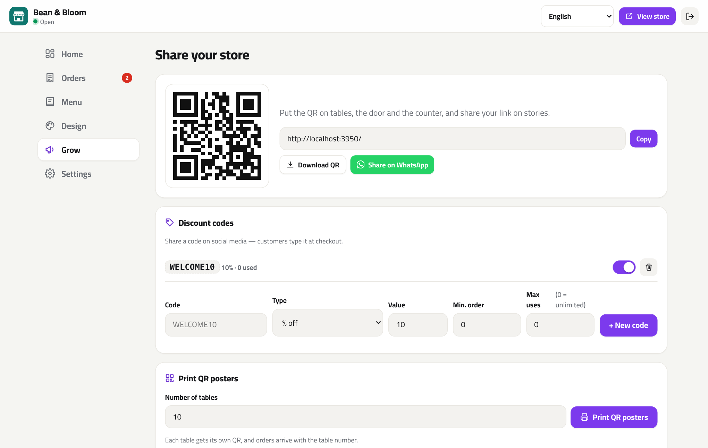

<div align="center">


# Dukkan · دكّان

**Your own WhatsApp ordering store & QR menu — live in 2 minutes.**
Self-hosted. Zero commissions. 8 languages out of the box.

[](https://www.hostinger.com/docker-hosting?compose_url=https://raw.githubusercontent.com/mashraf1997/dukkan/main/docker-compose.yml&REFERRALCODE=YOUR_REFERRAL_CODE)

[English](README.md) · [العربية](README.ar.md)

</div>

---

## Why Dukkan?

Millions of restaurants, cafés, bakeries and home businesses already take orders on **WhatsApp** — but customers have to ask *"what's on the menu?"*, prices get lost in chat, and orders arrive as messy voice notes.

Ordering SaaS tools fix that for **$15–$50/month plus commissions**. Dukkan does it for the price of the cheapest server:

1. **Deploy** with one click — HTTPS included.
2. **Open your shop** with a 1-minute setup wizard (a sample menu in your language is included so it looks alive straight away).
3. **Share your link or QR code.** Customers browse a beautiful mobile menu, fill a cart and tap **"Send order on WhatsApp"** — you receive a clean, numbered, fully-priced order in your WhatsApp.

No app to install for customers. No commission per order. Your data stays on your server.

## Features


**Design**
- 🎨 **4 themes** — Modern, Photo grid, Elegant (dark, printed-menu style) and Bold — plus **5 fonts** that all support Arabic, and any brand colour
- 📱 **Live phone preview** in the admin: see every change instantly, publish when you're happy
- ✨ Polished details: storefront header with live *Open now* status and one-tap WhatsApp / call / map / share, a *Popular* carousel, products that fly into the cart, swipe-down sheets, an animated order confirmation
- 🖼️ No photos yet? Every item gets its own soft colour tile behind its emoji, so the menu still looks designed

**For customers**
- ⚡ Fast, mobile-first menu (server-rendered, no framework, works on cheap phones)
- 🌍 **8 languages** — English, العربية (RTL), Español, Português, Français, Türkçe, Bahasa Indonesia, हिन्दी — switchable from the menu
- 🔎 Instant search and sticky category tabs
- 🧺 Cart with sizes / options (e.g. Small · Medium · Large, each with its own price)
- 🚚 Delivery (with **delivery areas** and per-area fees), 🛍️ pickup or 🍽️ **dine-in with table number** (from the table's QR code)
- 🏷️ **Discount codes** at checkout
- 💬 One tap sends a clear, formatted order to the shop's WhatsApp
- 🌗 Light & dark mode; remembers name, phone and address for next time

**For shop owners**
- 🧙 1-minute setup wizard with an optional sample menu
- 📊 Dashboard: KPIs with **trends vs the previous period**, interactive 14-day chart (orders or revenue), **busiest hours**, how customers order (delivery / pickup / dine-in), **visitors & conversion rate**, best sellers
- 🧾 Order inbox with statuses (new → confirmed → done), sound alert on new orders, one-tap chat with the customer, **80 mm receipt printing** for kitchen / cashier printers
- 📲 **Instant Telegram notifications** for every new order, free with your own bot ([how](#telegram-notifications))
- 🍽️ Menu manager: categories, photos (auto-compressed in the browser) or emoji, sizes, "featured" badge, sold-out toggle, reordering
- 📄 **Import / export the menu from Excel or Google Sheets** (CSV) — great for big menus
- 🕒 **Opening hours schedule** — the shop opens and closes itself (time-zone aware, hours past midnight supported)
- 🎨 Your logo, cover photo and brand colour
- 💰 Delivery fee, delivery areas, free-delivery threshold, minimum order, open / closed switch
- 📱 QR code for your shop + **printable QR posters for every table**
- 💾 One-click backup & restore (JSON)

**For the server**
- Node.js + Express, **2 dependencies**, no database to set up (atomic JSON files)
- Runs happily on the smallest VPS (~60 MB RAM)
- **Automatic HTTPS** with Caddy — just set your domain
- **Setup code** protects a fresh install from being claimed by someone else
- **Demo mode** for a public, self-resetting showcase
- Prices are always recalculated server-side, inputs sanitized, sessions signed, login rate-limited
- Docker image for `amd64` and `arm64`, health check included, tested on Node 18–24

## Screenshots

| Store (Arabic) | Store (English, table QR) | Checkout with discount code |
|---|---|---|
|  |  |  |

| Dashboard | Orders | Menu manager |
|---|---|---|
|  |  |  |

| Design with live preview | Delivery areas & opening hours | Discount codes & QR |
|---|---|---|
|  |  |  |

What the shop receives on WhatsApp:

```text
🛒 *New order #1024*
🏪 Bean & Bloom
━━━━━━━━━━
2× Latte (Large) — $11
1× Butter Croissant — $3.50
━━━━━━━━━━
Subtotal: $14.50
Discount (WELCOME10): -$1.45
Delivery: $4
*Total: $17.05*

🚚 Delivery
👤 Customer: Maya
📞 Phone: +1 415 555 0142
🗺️ Area: Uptown
📍 Address: 45 Oak Avenue, Apt 3
```

## Deploy

### Option 1 — One click on a Hostinger VPS (recommended)

1. Click **Deploy on Hostinger** above. Hostinger's Docker Manager reads [`docker-compose.yml`](docker-compose.yml), which runs Dukkan behind [Caddy](https://caddyserver.com).
2. **Optional — HTTPS:** point your domain's DNS **A record** at the VPS IP and set the environment variable `DOMAIN=shop.example.com`. Caddy gets and renews a free certificate automatically. Without `DOMAIN`, Dukkan is served over plain HTTP on the server's IP.
3. **Get your setup code:** open the `dukkan` container's **logs** in Docker Manager and copy the line `Setup code: XXXX-XXXX` — or set your own with the `SETUP_CODE` environment variable before deploying.
4. Open your domain (or `http://YOUR-SERVER-IP`), go to `/admin`, enter the code and finish the 1-minute setup.

> The smallest VPS plan is plenty — Dukkan uses very little memory.

### Option 2 — Hostinger Node.js web app

1. In hPanel go to **Websites → Add website → Node.js app → Import Git repository** and pick your fork of this repo.
2. Framework: **Express**, Node version **20+**, entry file `server.js` (start command `npm start`).
3. Add environment variables:
   - `SETUP_CODE` — any code you choose; you'll type it in the setup wizard.
   - `DATA_DIR` — a folder **outside** the deployed app folder (for example `/home/<your-user>/dukkan-data`) so your menu and orders survive redeploys.
4. Deploy, open your domain, and finish the setup wizard. HTTPS is handled by Hostinger.

### Option 3 — Docker anywhere

```bash
curl -O https://raw.githubusercontent.com/mashraf1997/dukkan/main/docker-compose.yml
```

```bash
DOMAIN=shop.example.com docker compose up -d
```

```bash
docker compose logs dukkan | grep "Setup code"
```

Or just the app, without Caddy:

```bash
docker run -d --name dukkan -p 80:3000 -v dukkan-data:/data --restart unless-stopped ghcr.io/mashraf1997/dukkan:latest
```

### Option 4 — Plain Node.js

```bash
git clone https://github.com/mashraf1997/dukkan.git
cd dukkan
npm install --omit=dev
npm start
```

Open <http://localhost:3000/admin> and use the setup code printed in the terminal.

## Configuration

Everything else is configured from the admin panel (`/admin`). Environment variables:

| Variable | Default | Description |
|---|---|---|
| `PORT` | `3000` | HTTP port |
| `HOST` | `0.0.0.0` | Interface to bind |
| `DATA_DIR` | `./data` (`/data` in Docker) | Where the menu, orders, stats and uploaded photos are stored |
| `SETUP_CODE` | random, printed in the logs | Code required to create the admin account on a fresh install |
| `DOMAIN` | *(empty)* | **docker-compose only.** Your domain for automatic HTTPS via Caddy |
| `TRUST_PROXY` | `loopback, linklocal, uniquelocal` | Express `trust proxy` setting, used for HTTPS detection and rate limiting behind a reverse proxy |
| `DEMO_MODE` | `false` | `true` turns the install into a public demo (see below) |
| `DEMO_PASSWORD` | `demo1234` | Admin password shown to demo visitors |
| `DEMO_RESET_MINUTES` | `60` | How often the demo wipes itself and re-seeds |
| `DEMO_LANG` | `en` | Language of the demo shop |

### Import a menu from Excel / Google Sheets

In **Menu → Import from Excel / CSV**, download the template, fill it, save as CSV and upload. Columns (only `name` is required):

| category | name | description | price | sizes | compare_price | emoji | image_url | available | featured |
|---|---|---|---|---|---|---|---|---|---|
| Pizza | Margherita | Tomato, mozzarella | | `Medium:8 \| Large:11` | | 🍕 | | yes | yes |
| Drinks | Lemonade | Fresh lemons | 3 | | 4 | 🍋 | | yes | no |

Categories are created automatically. Comma, semicolon and tab separators all work, and the export opens correctly in Excel (UTF-8 with BOM) for every language.

### Run your own live demo

```bash
docker run -d -p 80:3000 -e DEMO_MODE=true ghcr.io/mashraf1997/dukkan:latest
```

Visitors can log in with the password shown on screen and try everything; password changes and backup restores are disabled, and the whole shop resets every hour with sample orders, visitors and a `WELCOME10` discount code.

### Telegram notifications

Get a free, instant message on your phone for every new order, even when the admin panel is closed:

1. In Telegram, open [@BotFather](https://t.me/BotFather), send `/newbot` and copy the token it gives you.
2. Paste the token in **Settings → Instant notifications (Telegram)**, then open your new bot and press **Start**.
3. Press **Find my chat**, then **Send test**.

The message includes a link straight to the order inbox. To send notifications to a group, add the bot to the group and send a message there before pressing *Find my chat*. The bot token is stored on your server only: it's never shown again in the browser and is left out of backups.

### Multiple branches

Each branch runs its own copy of Dukkan: its own admin, menu, data and WhatsApp number, usually on its own subdomain (`downtown.example.com`, `mall.example.com`…). Copies are tiny (about 60 MB of RAM each), so one small VPS can run many.

[`examples/branches/`](examples/branches) has a ready-to-use `docker-compose.yml` and `Caddyfile` for two branches behind automatic HTTPS. To add a branch, copy a service block, give it a new volume, and add one line to the `Caddyfile`. Point each subdomain's DNS at the server, run `docker compose up -d`, and open each subdomain's `/admin` to set it up. On a Hostinger VPS you can also deploy the template several times instead.

### Data & backups

All data lives in `DATA_DIR`:

```
data/
├── db.json        # settings, categories, products, discount codes
├── orders.json    # order history
├── stats.json     # daily visitor counts
└── uploads/       # photos
```

Back it up by copying the folder, or use **Settings → Backup** in the admin panel to download / restore a JSON file (handy for moving to a new server).

## Security notes

- A fresh install can only be claimed with the **setup code** from the server logs (or `SETUP_CODE`), so nobody who stumbles on your IP can take over the shop.
- Passwords are hashed with scrypt; sessions are HMAC-signed, `HttpOnly`, `SameSite=Strict` cookies. Changing the password signs out all other sessions.
- State-changing API calls require a custom header (CSRF protection); login, setup, order and discount-code endpoints are rate-limited.
- Customers can't tamper with prices or discounts: every order is re-priced from the catalogue on the server.

## Development

```bash
npm install
npm run dev    # auto-restarts on changes
npm test       # 37 tests (node:test, no extra deps)
```

Project layout:

```
server.js            entry point
src/app.js           routes & API
src/store.js         JSON storage (atomic writes)
src/orders.js        cart validation, pricing, discounts, WhatsApp message
src/schedule.js      opening hours
src/csv.js           Excel / CSV import & export
src/demo.js          demo mode
src/views.js         server-rendered storefront, QR posters & receipts
src/theme.js         themes & fonts
public/css/store.css storefront styles (one block per theme)
public/img/icons.svg SVG icon sprite
src/i18n.js          loads locales/*.json
locales/             one JSON file per language
public/              storefront & admin (vanilla JS + CSS)
```

### Adding a language

Copy `locales/en.json` to `locales/<code>.json`, translate the values, and set `meta.name` and `meta.dir` (`ltr` or `rtl`). It appears in the storefront and admin automatically; the test suite checks that no key is missing. Optionally add a sample menu for it in `src/sample.js`. PRs welcome!

## Roadmap

- [x] More languages
- [x] Opening-hours schedule
- [x] Delivery areas with different fees
- [x] Discount codes
- [x] Import menu from Excel / CSV
- [x] Automatic HTTPS
- [x] Storefront themes, fonts & live preview
- [x] Telegram notifications for new orders
- [ ] Add-ons per product (extra cheese, sauces…)
- [x] Multiple branches (one instance per branch, [example](examples/branches))
- [ ] Email notifications

## License

[MIT](LICENSE) — free for personal and commercial use.
