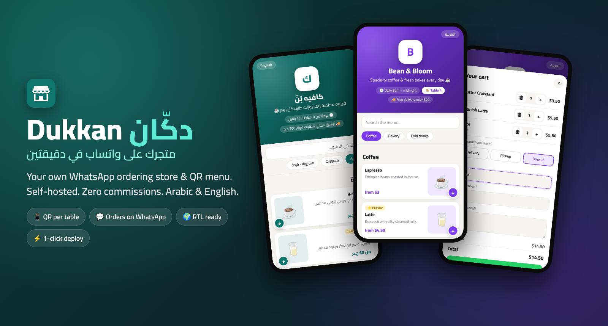
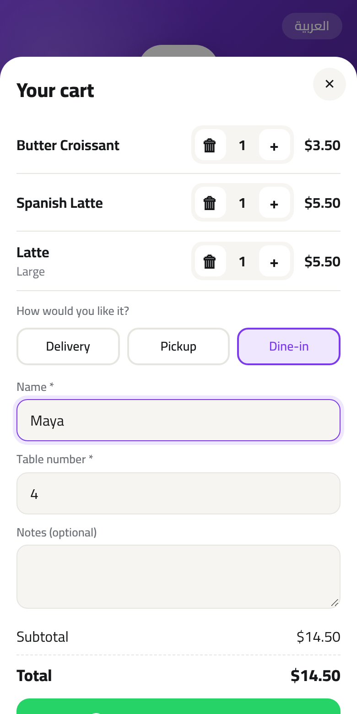

<div align="center">



# Dukkan · دكّان

**Your own WhatsApp ordering store & QR menu — live in 2 minutes.**
Self-hosted. Zero commissions. Arabic & English out of the box.

[](https://www.hostinger.com/docker-hosting?compose_url=https://raw.githubusercontent.com/mashraf1997/dukkan/main/docker-compose.yml&REFERRALCODE=YOUR_REFERRAL_CODE)

[English](README.md) · [العربية](README.ar.md)

</div>

---

## Why Dukkan?

Millions of restaurants, cafés, bakeries and home businesses already take orders on **WhatsApp** — but customers have to ask *"what's on the menu?"*, prices get lost in chat, and orders arrive as messy voice notes.

Ordering SaaS tools fix that for **$15–$50/month plus commissions**. Dukkan does it for the price of the cheapest server:

1. **Deploy** with one click.
2. **Open your shop** with a 1-minute setup wizard (a sample menu is included so it looks alive straight away).
3. **Share your link or QR code.** Customers browse a beautiful mobile menu, fill a cart and tap **"Send order on WhatsApp"** — you receive a clean, numbered, fully-priced order in your WhatsApp.

No app to install for customers. No commission per order. Your data stays on your server.

## Features

**For customers**
- ⚡ Fast, mobile-first menu (server-rendered, no framework, works on cheap phones)
- 🔎 Instant search and sticky category tabs
- 🧺 Cart with sizes / options (e.g. Small · Medium · Large, each with its own price)
- 🚚 Delivery, 🛍️ pickup or 🍽️ **dine-in with table number** (from the table's QR code)
- 💬 One tap sends a clear, formatted order to the shop's WhatsApp
- 🌍 Arabic (RTL) and English, light & dark mode
- 🔁 Remembers name, phone and address for next time

**For shop owners**
- 🧙 1-minute setup wizard with an optional sample menu
- 📊 Dashboard: today's orders, 7/30-day sales, average order, best sellers, 14-day chart
- 🧾 Order inbox with statuses (new → confirmed → done), sound alert on new orders, one-tap chat with the customer
- 🍽️ Menu manager: categories, photos (auto-compressed in the browser) or emoji, sizes, "featured" badge, sold-out toggle, reordering
- 🎨 Your logo, cover photo and brand colour
- 💰 Delivery fee, free-delivery threshold, minimum order, open / closed switch
- 📱 QR code for your shop + **printable QR posters for every table**
- 💾 One-click backup & restore (JSON)

**For the server**
- Node.js + Express, **2 dependencies**, no database to set up (atomic JSON files)
- Runs happily on the smallest VPS (~60 MB RAM)
- Prices are always recalculated server-side, inputs sanitized, sessions signed, login rate-limited
- Docker image for `amd64` and `arm64`, health check included

## Screenshots

| Store (Arabic) | Store (English, table QR) | Checkout |
|---|---|---|
|  |  |  |

| Dashboard | Orders | Menu manager |
|---|---|---|
|  |  |  |

What the shop receives on WhatsApp:

```text
🛒 *New order #1024*
🏪 Bean & Bloom
━━━━━━━━━━
2× Latte (Large) — $11
1× Butter Croissant — $3.50
━━━━━━━━━━
Subtotal: $14.50
Delivery: $2
*Total: $16.50*

🚚 Delivery
👤 Customer: Maya
📞 Phone: +1 415 555 0142
📍 Address: 45 Oak Avenue, Apt 3
```

## Deploy

### Option 1 — One click on a Hostinger VPS (recommended)

Click **Deploy on Hostinger** above. Hostinger's Docker Manager reads [`docker-compose.yml`](docker-compose.yml) and starts Dukkan on port 80. Open `http://YOUR-SERVER-IP` and complete the setup wizard.

Then point your domain at the VPS. For HTTPS, put any reverse proxy in front (Hostinger's Docker catalogue has Traefik / Nginx Proxy Manager templates, or use Caddy).

> The smallest VPS plan is plenty — Dukkan uses very little memory.

### Option 2 — Hostinger Node.js web app

1. In hPanel go to **Websites → Add website → Node.js app → Import Git repository** and pick your fork of this repo.
2. Framework: **Express**, Node version **20+**, entry file `server.js` (start command `npm start`).
3. Add the environment variable `DATA_DIR` pointing to a folder **outside** the deployed app folder (for example `/home/<your-user>/dukkan-data`) so your menu and orders survive redeploys.
4. Deploy, open your domain, and finish the setup wizard.

### Option 3 — Docker anywhere

```bash
docker run -d --name dukkan -p 80:3000 -v dukkan-data:/data --restart unless-stopped ghcr.io/mashraf1997/dukkan:latest
```

### Option 4 — Plain Node.js

```bash
git clone https://github.com/mashraf1997/dukkan.git
cd dukkan
npm install --omit=dev
npm start
```

Open <http://localhost:3000>.

## Configuration

Everything is configured from the admin panel (`/admin`). Optional environment variables:

| Variable | Default | Description |
|---|---|---|
| `PORT` | `3000` | HTTP port |
| `HOST` | `0.0.0.0` | Interface to bind |
| `DATA_DIR` | `./data` (`/data` in Docker) | Where the menu, orders and uploaded photos are stored |
| `TRUST_PROXY` | `loopback, linklocal, uniquelocal` | Express `trust proxy` setting, used for HTTPS detection and rate limiting behind a reverse proxy |

### Data & backups

All data lives in `DATA_DIR`:

```
data/
├── db.json        # settings, categories, products
├── orders.json    # order history
└── uploads/       # photos
```

Back it up by copying the folder, or use **Settings → Backup** in the admin panel to download / restore a JSON file (handy for moving to a new server).

## Security notes

- The first person to open a fresh install creates the admin account (like WordPress). **Finish the setup right after deploying.**
- Passwords are hashed with scrypt; sessions are HMAC-signed, `HttpOnly`, `SameSite=Strict` cookies. Changing the password signs out all other sessions.
- State-changing API calls require a custom header (CSRF protection) and the login and order endpoints are rate-limited.
- Customers can't tamper with prices: every order is re-priced from the catalogue on the server.

## Development

```bash
npm install
npm run dev    # auto-restarts on changes
npm test       # API & flow tests (node:test, no extra deps)
```

Project layout:

```
server.js            entry point
src/app.js           routes & API
src/store.js         JSON storage (atomic writes)
src/orders.js        cart validation, pricing, WhatsApp message
src/views.js         server-rendered storefront & QR posters
src/i18n.js          Arabic / English strings
public/              storefront & admin (vanilla JS + CSS)
```

Adding a language = adding a block to `src/i18n.js` (storefront) and `public/js/admin.js` (admin). PRs welcome!

## Roadmap

- [ ] More languages (French, Turkish, Urdu, Indonesian, Spanish, Portuguese)
- [ ] Opening-hours schedule that opens / closes the shop automatically
- [ ] Delivery zones with different fees
- [ ] Coupon codes
- [ ] Telegram notification for new orders

## License

[MIT](LICENSE) — free for personal and commercial use.
